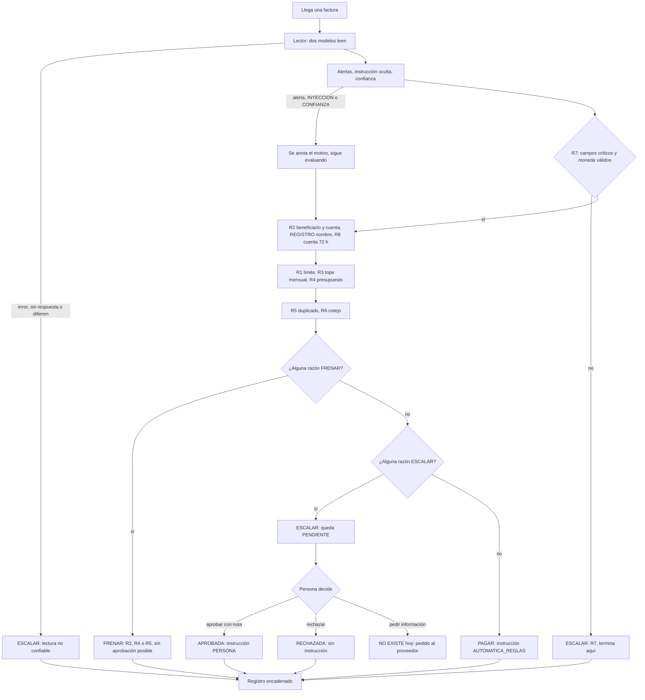
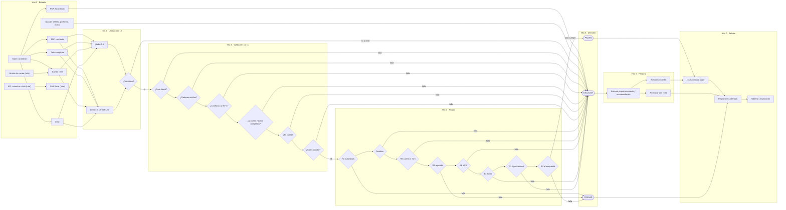

# Mapa de escenarios: clientes, entradas, salidas y decisiones

**Emitido:** 17/10/2026 - 3:31 p.m. (Caracas, Venezuela). Investigación con agentes Sonnet (4 frentes + síntesis + crítica adversarial), revisada y decidida por el integrador.
**Diagrama de flujo con todos los hitos y ramas (FigJam):** https://www.figma.com/board/Z35gyUNofAP7wy2AWshTI6 · copia en Mermaid en la sección 8.
Las etiquetas [verificado: URL] y [supuesto] vienen de la investigación. Nada de este documento sobre Blinka es un dato de sus clientes: es una deducción a partir de su web y la prensa.

## 0. Decisiones tomadas tras la crítica adversarial

| Punto de la crítica | Decisión |
|---|---|
| El caso "beneficiario casi idéntico → guardar alias" convierte un FRENAR en pagable | **Descartado.** FRENAR nunca se aprueba. |
| "Aprobar y crear regla" y aprobación en lote | **Fuera del hackathon y fuera del material para el jurado.** Relajan reglas por costumbre. |
| Botón recomendado primero y relleno | En casos con riesgo (cuenta cambiada, instrucción oculta, no cuadra) **Aprobar y Rechazar con el mismo peso visual**; la recomendación va como frase. |
| Cuenta cambiada ≤ 72 h | Sigue siendo ESCALAR (decide una persona, como pide el reto), pero aprobar exige escribir **"Confirmé el cambio por un teléfono que ya tenía"** y una nota; queda en el registro. |
| La seguridad debe vivir en el servidor, no en la pantalla | **Obligatorio** para el rediseño de Codex: probar por API que FRENAR responde 403 y que nada nuevo permite aprobar sin pasar por el motor. |
| Validar rangos de reglas editables (límite 0, tolerancia 100 %, confianza 0) | **Tarea para Andrés** (`/reglas`, validación en servidor). |
| Facturas del mismo lote que juntas superan el tope | **Prueba a añadir** (orden de proceso y presupuesto consumido). |
| Factura corregida con el mismo número | Queda FRENADA como duplicado; **se documenta** como limitación conocida y caso de hoja de ruta. |
| Notas de crédito/proformas, chequeo aritmético, fallo del modelo → ESCALAR | **Se implementan ya** en el lector (zona de Sebastián), con pruebas. |
| Tabla de 10 perfiles de cliente | Es deducción; **no va al pitch**. Para la demo se usa un perfil: empresa de EE. UU. con proveedores en LATAM. |
| Cifras de Blinka (US$10 M, etc.) | **No se usan** en el pitch. |
| `CLAUDE.md` de la carpeta raíz desactualizado (37 pruebas, Andina, Luna) | **Corregido:** ahora apunta al repo del equipo. |

## 1. Resumen en 8 viñetas

- **Cliente probable:** empresa constituida en EE. UU. con equipo, proveedores o dueños en LATAM. El agente cubre el lado "pagar proveedores" de Blinka. [supuesto: la web no segmenta clientes ni dice quién aprueba pagos hoy]
- **Qué se sabe de Blinka:** cuentas USD, pagos ACH/wire/SWIFT, rutas locales (SPEI, Pix, Bre-B), back-office. La web muestra 11 logos sin descripción. No hay clientes, volumen ni precios verificables. [verificado: https://www.blinka.co]
- **Perfil para la demo:** A1, startup/SaaS en EE. UU. con equipo en LATAM. Es Aurora Cloud, la empresa ficticia del set de 18 facturas (F-001…F-018).
- **Entradas que cubrimos:** PDF con texto, imágenes, `.eml` y chat `.txt`. **No cubrimos:** PDF escaneado (siempre escala), XML fiscal (CFDI, DIAN, UBL), lotes Excel/CSV, notas de crédito, proformas y recibos. Verificado en `src/extraccion/archivo.ts`.
- **Salidas que existen:** PAGAR, FRENAR y ESCALAR (pendiente, aprobada o rechazada), explicación, registro encadenado, falla cerrada. **No existen:** pago programado, pedir información al proveedor, anulada, notificaciones, export CSV, campos por riel.
- **Árbol de decisión:** se revisan las comprobaciones siempre y manda la falla más grave (FRENAR > ESCALAR > PAGAR). Cualquier error interno termina en ESCALAR.
- **UX:** hoy la cola ofrece el mismo Aprobar/Rechazar para todo. El diseño propuesto da 7 casos con botones propios, y en los casos de instrucción oculta y cuenta reciente no hay botón de aprobar.
- **Para el domingo:** no ampliar el alcance. Lo único con relación directa con seguridad es bloquear notas de crédito, proformas y recibos como cobro, y el chequeo aritmético. El resto se presenta como hoja de ruta.

---

## 2. Clientes posibles

Todo es [supuesto], deducido de los rieles que Blinka lista. Los volúmenes son rangos cualitativos.

| Perfil | Quién es | Paga a | Volumen | Quién aprueba hoy | Reglas que más le importan |
|---|---|---|---|---|---|
| **A1** Startup/SaaS en EE. UU. con equipo LATAM | 10–80 personas | Contratistas, agencias, SaaS, hosting | Medio | Fundador o CFO fraccional | R5, R6, R7, R1, R4 |
| **A2** Pyme LATAM exportadora con entidad Delaware | 5–50 personas | Proveedores locales, contador, logística | Bajo–medio | El dueño | R8, R2, R7, R6 |
| **A3** Fintech/cripto/infra que dispersa | 10–100 personas | Infraestructura, liquidez, auditoría | Medio–alto, montos grandes | CFO y segundo aprobador | R1, R3, R2, R8, confianza |
| **B1** Agencia con freelancers | 5–40 personas | Freelancers, herramientas | Muchas facturas pequeñas | Director o PM, por chat | R5, R3, R6, R7, nombre |
| **B2** Marketplace con cientos de vendedores | 20–200 personas | Vendedores, en lote | Alto | Proceso automático y operaciones | R3, R5, R8, R2, instrucción oculta |
| **B3** Contratistas recurrentes | 15–150 personas | Contratistas individuales | Medio, recurrente | RR. HH. o finanzas | R3, R6, R8, R5 |
| **B4** Importador con proveedores en Asia | 5–50 personas | Fabricantes, logística | Bajo–medio, pagos grandes | El dueño | R1, R2, R8, R6, R7 |
| **C1** Empresa familiar con administradora mayor | 5–30 personas | Proveedores de siempre, nómina | Bajo–medio | Una administradora, a mano | R8, R2, R5, nombre, instrucción oculta |
| **C2** Holding con varias entidades | 10–100 personas | Administradores, custodios, abogados | Medio, montos altos | CFO y comité | R4, R1, R2 por entidad, R3 |
| **D1** Startup de 5 personas | 2–8 personas | SaaS, 1–3 contratistas | Muy bajo | El fundador, de memoria | R5, R7, R1, y que no escale de más |

Notas por perfil:
- **A1:** perfil de demo.
- **C1:** mejor argumento de seguridad. Cuenta cambiada y explicación sin jerga lucen más ante un jurado.
- **B2:** el cuello de botella es el volumen, no la IA. Lo más probable es que la cola de ESCALAR crezca.
- **C2:** requiere reglas por entidad. Hoy el modelo es de una sola empresa. [verificado: CLAUDE.md del proyecto]
- **D1:** si todo escala, el agente no ahorra tiempo.

**Qué no afirmar:** que Blinka tenga tal tipo de cliente. Solo se puede decir que la web muestra 11 logos sin descripción. [verificado: https://www.blinka.co]

Datos de contexto de Blinka:
- **Foco declarado:** empresas de EE. UU. con dueños, equipo, proveedores o clientes en LATAM. [verificado: portafolio.co, solo resultado de búsqueda, no se leyó el artículo]
- **Dolor que citan:** abrir una empresa en Delaware solo para cobrar en dólares. [verificado: latamfintech.co]
- **Empresa:** fundada en 2024, unas 7 personas. Dicen haber procesado más de US$10 millones en dos meses, sin cliente ni ingreso verificable. [verificado: latamfintech.co y resultados de búsqueda]

---

## 3. Árbol de entradas

Estado de lo que ya lee el producto (verificado en `src/extraccion/archivo.ts` y `docs/extraccion.md`):
- PDF con texto: se lee con `pdftexto.ts`.
- PDF sin texto: devuelve vacío y escala.
- PNG, JPG y WEBP: van como base64 a los dos modelos.
- `.eml` y `.txt`: se leen como texto plano.
- Todo lo demás: sin ruta de entrada.

```
Entrada
├── Formato de archivo
│   ├── PDF nativo / escaneado / varias facturas
│   ├── Imagen (foto, captura, borrosa, rotada)
│   ├── XML fiscal (CFDI, DIAN, SUNAT, UBL/Peppol, NF-e)
│   ├── Hoja de cálculo (Excel, CSV de lote o nómina)
│   ├── Texto (correo .eml, chat, audio)
│   └── Documentos que no son cobro (nota de crédito, proforma, recibo)
├── Canal
│   ├── Subir o arrastrar
│   ├── Buzón / conector de bandeja
│   ├── API o webhook
│   ├── Lote y facturas recurrentes
│   └── Entrada manual
└── Variaciones de contenido
    ├── Moneda, totales, impuestos, descuentos, anticipos, parciales
    ├── Idioma y formato de fecha
    ├── Formatos de cuenta (ABA, IBAN, CLABE, Pix, Bre-B)
    └── Trampas (datos faltantes, instrucción oculta, falsificación)
```

### 3.1 Formatos y documentos

| Entrada | Qué debe hacer el sistema | ¿Lo cubrimos hoy? |
|---|---|---|
| PDF nativo | Leer y comprobar el texto literal; si hay instrucción, ESCALAR | Sí |
| PDF escaneado | Hoy escala. Mejora: renderizar páginas a imagen y mandarlas a los dos modelos | Parcial (siempre escala) |
| Foto de celular | Doble lectura; si difieren, ESCALAR | Sí |
| Captura de pantalla | Datos faltantes: ESCALAR y pedir el dato | Sí (como imagen) |
| Imagen borrosa | ESCALAR por datos o confianza (caso F10) | Sí |
| Imagen rotada | Sin evidencia | [supuesto] |
| PDF con varias facturas | Detectar más de un número y ESCALAR | No |
| XML CFDI (México) | Parsear con código, no con IA: `Moneda`, `TipoCambio`, `Total`, RFC | No |
| XML DIAN (Colombia), SUNAT (Perú) | Parsear UBL 2.1 | No |
| NF-e / NFS-e (Brasil) | Parsear XML | No [supuesto: formato no confirmado] |
| SENIAT (Venezuela) | Tratar como PDF o imagen | Parcial [supuesto: no se confirmó si hay XML] |
| UBL / Peppol | Tipo 380 es factura, 381 es nota de crédito; rechazar 381 como pago | No |
| Excel/CSV de lote | Una fila, un pago, cada una con su registro | No |
| Correo con adjunto | Leer cuerpo y adjunto; si no coinciden, ESCALAR | Parcial (el `.eml` se lee como texto; los adjuntos no se extraen) |
| Correo sin adjunto | El cuerpo es la factura; es dato, nunca orden | Sí |
| WhatsApp o Slack | Si no hay monto claro, ESCALAR | Sí (texto) |
| Audio de voz | Transcribir, confianza baja por defecto; casi siempre ESCALAR | No |
| QuickBooks, Xero, Bill.com | Mapear columnas; mejor CSV o API | No |
| Deel, Upwork, Stripe, AWS | Verificar que el beneficiario sea el aprobado | Parcial (si llega como PDF) |
| Cuenta de cobro (persona natural) | Sin número de factura: ESCALAR | Parcial |
| Nota de crédito | Nunca PAGAR; registrar y ESCALAR | No |
| Proforma | FRENAR o ESCALAR; no es documento fiscal | No |
| Recibo | Cruzar con duplicados y ESCALAR | No |

### 3.2 Canales

| Canal | Nota | ¿Lo cubrimos hoy? |
|---|---|---|
| Subir archivo | La principal | Sí |
| Arrastrar y soltar | Solo cambia la interfaz | [supuesto] según la interfaz |
| Foto desde el móvil | Es subir una imagen | Sí (como imagen) |
| Reenviar a un buzón | Los remitentes se pueden falsificar | No |
| Conector de bandeja (Gmail, Outlook) | Requiere permisos de acceso | No |
| API o webhook | Misma entrada con autenticación | No |
| Carga por lotes | Aislar errores por factura | No |
| Entrada manual | La persona digita; se trata como dato sin verificar | No |
| Facturas recurrentes | Riesgo de falso duplicado | No |

Regla de seguridad: el correo del remitente nunca basta para aprobar nada.

### 3.3 Variaciones de contenido

| Variación | Qué hace el sistema | ¿Lo cubrimos hoy? |
|---|---|---|
| Moneda ambigua | Moneda nula y ESCALAR (caso F-012) | Sí |
| Varios totales, multi-línea, descuentos | Recalcular en código y comparar | Parcial (no hay chequeo aritmético) |
| Impuestos y retenciones | Pagar solo el neto, cruzado con lo acordado (R6) | Parcial |
| Anticipos, saldos, pagos parciales | ESCALAR si hay anticipo; cruzar con historial | No |
| Multi-entidad (factura para otra empresa) | Defensa de nombre | Sí |
| Idiomas es/pt/en | Probar con ejemplos reales | Parcial (hay un caso en BRL) |
| Fecha DD/MM contra MM/DD | Si es ambigua, ESCALAR | Parcial |
| ABA, IBAN, CLABE | Validar longitud y dígito de control en código | No |
| Clave Pix | Pedir el beneficiario de la clave y ESCALAR | No |
| Cuenta COP | Validar contra la cuenta registrada (R8) | Parcial |
| Datos faltantes | Campos nulos y ESCALAR | Sí |
| Instrucciones ocultas | ESCALAR siempre | Sí (texto y correo); en imágenes depende del modelo |
| Documento falsificado | Detecta cuenta cambiada, no el archivo | Parcial |

Verificado:
- Peppol BIS 3.0 se basa en UBL 2.1; 380 es factura y 381 es nota de crédito. [verificado: https://accp.econnect.eu/en/docs/learn/document-formats/formats/bis-billing-v3]
- DIAN y SUNAT usan XML UBL 2.1. [verificado: https://edicomgroup.com/es/factura-electronica/colombia, https://www.sunat.gob.pe/legislacion/superin/2019/133-2019.pdf]
- CFDI lleva `Moneda`, y `TipoCambio` es obligatorio si la moneda no es MXN. [verificado: https://expansion.mx/finanzas-personales/2022/02/16/como-hacer-factura-4-0-sat-2022]
- Las claves Pix son de cuatro tipos: CPF/CNPJ, correo, teléfono y aleatoria. [verificado: https://www.serasa.com.br/blog/chaves-pix/]
- La estructura de la CLABE (3 banco, 3 plaza, 11 cuenta, 1 control) es [supuesto], de memoria.
- No se pudo verificar: NF-e/NFS-e, SENIAT, estructura oficial de la CLABE ni el anexo técnico vigente de la DIAN.

---

## 4. Árbol de salidas y árbol de decisión

### 4.1 Salidas

**PAGAR**

| Variante | ¿Existe? |
|---|---|
| Pagar ahora (`AUTOMATICA_REGLAS`, genera instrucción de pago) | Sí |
| Programar al vencimiento (falta leer `fecha_vencimiento`, tarea "para cuándo") | No |
| Pagar parcial | No; no recomendado para el hackathon |

**FRENAR** (sin aprobación posible; una factura frenada devuelve 403 `NO_SE_PUEDE_APROBAR`)

| Razón | Regla | Se entera | Acción sugerida |
|---|---|---|---|
| Beneficiario o cuenta fuera de la lista | R2 | Compras | Verificar por canal conocido; dar de alta si es legítimo |
| Presupuesto de categoría superado | R4 | Dueño del presupuesto | Subir presupuesto o esperar al mes siguiente |
| Duplicado | R5 | Cuentas por pagar | Confirmar con el proveedor; descartar |

**ESCALAR** (queda `PENDIENTE`)

| Razón | Regla | Se entera | Acción sugerida |
|---|---|---|---|
| Sobre el límite por pago | R1 | Aprobador | Aprobar con nota, o pedir cuotas |
| Tope mensual por beneficiario | R3 | Aprobador | Aprobar o diferir |
| Presupuesto sin configurar | R4 | Dueño del presupuesto | Configurarlo |
| No cuadra con lo acordado | R6 | Quien compró | Pedir nota de crédito o factura corregida |
| Campos ilegibles o faltantes | R7 | Cuentas por pagar | Pedir documento legible |
| Cuenta cambiada ≤72 h | R8 | Tesorería y seguridad | Llamar a un teléfono ya conocido |
| Instrucción oculta | INYECCION | Seguridad | Tratar el documento como sospechoso |
| Confianza baja | CONFIANZA | Cuentas por pagar | Revisar contra el original |
| Nombre distinto al registrado | REGISTRO | Compras | Confirmar con el proveedor |
| Alerta de extracción | EXTRACCION | Seguridad | Revisar el original |
| Fallo interno | ESQUEMA | Equipo técnico | Reintentar y revisar el registro |

**Estados posteriores**

| Estado | ¿Existe? |
|---|---|
| Pendiente | Sí |
| Aprobada por persona (instrucción con `origen: PERSONA`) | Sí |
| Rechazada | Sí |
| Resolución repetida (409 `YA_RESUELTA`) | Sí, bloqueada |
| Pedido de información al proveedor | No |
| Vencida | No |
| Anulada (debería ser un asiento nuevo, nunca una edición) | No |

**Artefactos**

| Artefacto | ¿Existe? |
|---|---|
| Registro encadenado con hash y ancla externa (evidencia de manipulación, no inmutabilidad) | Sí |
| Explicación humana con cifras que salen solo de los hechos del motor | Sí |
| Instrucción de pago | Parcial: faltan riel, fecha, referencia y banco |
| Notificaciones (correo, Slack, WhatsApp) | No |
| Resumen diario o semanal | No (`resumen()` solo alimenta la pantalla) |
| Export CSV de conciliación | No |
| Métricas | Parcial: hay autonomía y conteos; faltan escalados por motivo y ahorro de tiempo |

**Campos que necesitaría una instrucción por riel.** Es diseño propuesto, no algo que el repo tenga hoy:

| Riel | Campos mínimos |
|---|---|
| ACH / wire doméstico | Nombre, routing, cuenta, tipo, monto, fecha, referencia (wire suma dirección) [supuesto: sin fuente oficial] |
| SWIFT | Referencia, código de operación, fecha-moneda-monto, banco y beneficiario [verificado: https://ohmyfin.ai/swift/mt103-fields-(swift)] |
| SPEI | CLABE de 18 dígitos [verificado: https://www.stelorder.com/mexico/blog/clabe/] |
| Pix | Chave: CPF, CNPJ, correo, teléfono o aleatoria [verificado: https://www.serasa.com.br/premium/blog/chave-pix/] |
| Bre-B | Llave: cédula, celular, correo o código [verificado: https://www.valoraanalitik.com/bre-b-banco-republica-llaves-registradas/] |

Advertencias:
- Las fuentes de Pix y SPEI son blogs comerciales, no normas oficiales.
- No se confirmó qué rieles ofrece Blinka a sus clientes. En el pitch decir "preparamos la instrucción", no "pagamos por Pix".

**Errores del sistema**

| Error | Salida segura | ¿Existe? |
|---|---|---|
| Excepción en el motor | ESCALAR / ESQUEMA | Sí |
| Modelo no responde, tarda o devuelve basura | ESCALAR con motivo técnico | [supuesto]: no se verificó en `extraer.ts` |
| Dos modelos leen distinto | ESCALAR | Sí, según el tablero del equipo |
| No se puede escribir en el registro | Se revierte la aprobación y devuelve 500 | Sí |
| Registro alterado | `verificarCadena` devuelve el primer fallo | Sí |
| Moneda sin tasa | R7 la marca inválida y escala | Sí |

### 4.2 Árbol de decisión



Punto abierto del equipo: "¿cómo cuenta un ESCALAR para la autonomía?". Hoy `resumen()` cuenta como acertada la factura cuya decisión coincide con la esperada, así que un ESCALAR correcto suma. Falta confirmarlo con el mentor antes del pitch.

---

## 5. Cómo el usuario solo decide

Este es el diseño propuesto. No está implementado y el metaprompt V2 no lo cubre.

**Reglas base**
- Aprobar no mueve dinero; emite una instrucción de pago. Por eso deshacer es posible hasta que se consuma.
- Deshacer es un asiento nuevo de anulación, no una edición. [supuesto: el registro lo admite; confirmar con Andrés]
- Máximo tres botones, en este orden: positivo, salida, "Decidir luego". El recomendado va primero y relleno.
- Una frase de motivo sin jerga: "Cobran 1.000 y acordamos 850", no "R6 fuera de ±2 %".

| Caso | Trabajo previo del sistema | Recomendación | Botones | Después |
|---|---|---|---|---|
| **1. Sobre el límite (R1)** | Compara con el límite, comprueba las otras comprobaciones, calcula cuánto se pasa, busca pagos anteriores | Aprobar, solo si lo demás está en verde: "Pasa tu límite por USD 200" | Aprobar este pago · Rechazar · Decidir luego | Aprobar: nota de una frase e instrucción de pago. Rechazar: queda frenada y se ofrece plantilla al proveedor. Deshacer 30 s, luego "Anular instrucción" mientras no se consuma |
| **2. No cuadra con lo acordado (R6)** | Busca el acuerdo vigente, calcula la diferencia en dinero y %, busca la factura anterior parecida | Pedir corrección: "Cobran 1.000, acordamos 850, sobran 150" | Pedir corrección · Aprobar de todos modos · Decidir luego | Corrección: prepara el mensaje para que lo envíes tú, recordatorio a 3 días. "De todos modos": confirmación con palabras y nota obligatoria |
| **3. Datos ilegibles o faltantes (R7)** | Lista el campo que falta, reintenta con la segunda lectura, recorta la zona dudosa | Pedir otra copia: "No pudimos leer el monto" | Pedir otra copia · Escribir el dato yo · Decidir luego | El dato tecleado se marca "puesto por una persona" y la factura vuelve a pasar por todas las comprobaciones. Completar un dato no aprueba el pago |
| **4. Cuenta cambiada (R8, ≤72 h)** | Compara cuenta nueva con anterior, calcula las horas, mira por qué canal llegó el cambio | Esperar y confirmar por otro canal: "Cambió hace 20 horas" | Confirmar con el proveedor · Rechazar · Decidir luego (**sin Aprobar** hasta las 72 h) | Guion de llamada al contacto guardado antes del cambio, nunca al de la factura. Al marcar "Confirmado por teléfono" queda registrado y puede aprobarse |
| **5. Instrucción oculta** | Extrae el texto exacto, lo ubica en la factura, comprueba el resto, busca el mismo patrón en el remitente | Rechazar: "Trae un texto que intenta darle órdenes al sistema" | Rechazar y avisar a seguridad · Revisar la factura completa · Decidir luego (**sin Aprobar**) | Queda frenada y el remitente se marca sospechoso. Para pagar, se pide una factura limpia como factura nueva |
| **6. Confianza baja** | Compara las dos lecturas, identifica los campos que difieren, muestra qué cambia según cuál sea correcta | Elegir la lectura correcta: "1.200 o 1.700" | Es 1.200 · Es 1.700 · Decidir luego [supuesto: botones generados con los valores en disputa] | Se re-evalúa todo con el valor elegido. Elegir no aprueba |
| **7. Beneficiario casi idéntico** | Calcula similitud con los autorizados, compara ID fiscal y cuenta, resalta letras que difieren | Tratar como distinto hasta confirmar | Es el mismo proveedor · Es otro (frenar) · Decidir luego | "Es el mismo" solo se acepta si el ID fiscal coincide; si no, botón deshabilitado con la razón. Si coincide, se guarda un alias |

**Patrones transversales**
- **Aprobación en lote:** solo casos 1 y 7, misma causa y mismo proveedor, con el total escrito en la confirmación. Nunca nada frenado, con instrucción oculta, cuenta cambiada o datos dudosos. El total no puede superar el tope mensual restante.
- **"Decidir luego":** pide cuándo ("mañana a las 9" por defecto) y sube la factura al tope ese día.
- **"Aprobar y crear regla":** solo tras una aprobación manual repetida (valor de partida: 3 veces), con vista previa del efecto, caducidad a 90 días y sin subir el límite global. Nunca desde instrucción oculta ni cuenta cambiada.
- **Plantillas al proveedor:** el sistema las redacta y tú las envías, nunca salen solas. Sin datos bancarios completos y con el teléfono guardado antes del cambio.
- **Orden de la bandeja:** primero lo que vence antes, luego el monto mayor, luego la antigüedad. Agrupada por tipo de caso con conteo.

**Cinco principios medibles**
1. Al menos 80 % de las escalaciones se resuelve con el botón recomendado.
2. Mediana de 10 s o menos por decisión en un caso estándar.
3. Cero términos técnicos fuera de la capa de evidencia, y nada bajo 16 px.
4. 100 % de las acciones con "Deshacer" o confirmación con palabras.
5. Ninguna ruta de botón (individual, lote, regla nueva, dato escrito a mano) convierte en pagada una factura con instrucción oculta, cuenta reciente o dato faltante sin pasar por todas las comprobaciones. Si falla, no hay demo.

**No verificado:** si el registro admite asiento de anulación, si hay un contacto guardado por proveedor, y los umbrales (30 s de deshacer, 3 repeticiones, 90 días), que son valores de partida.

---

## 6. Brechas priorizadas

Calendario (hora Caracas): Codex entrega a las 9:00 p.m. hoy. HITO V1, congelar funciones, el sábado 17/10 a las 11:00 p.m. Cierre el domingo 18/10 a la 1:00 p.m.; el domingo de 7:00 a 11:00 a.m. es solo para casos extra, README y video, sin funciones nuevas. Por eso el criterio es: no ampliar el alcance salvo lo que toca la regla de seguridad.

### Antes del domingo 1:00 p.m., en orden de impacto

| # | Brecha | Mejora | Costo | Por qué |
|---|---|---|---|---|
| 1 | Notas de crédito, proformas y recibos podrían leerse como cobro | Seguridad | Bajo: defensa barata | Relación directa con "un pago indebido descalifica" |
| 2 | Sin chequeo aritmético (líneas, subtotal, total, retenciones) | Seguridad | Bajo–medio: lo hace el código | Evita pagar un total que no cuadra |
| 3 | Confirmar que modelo caído, lento o con basura termina en ESCALAR en `extraer.ts` | Seguridad | Mínimo: solo verificar | Principio 8; hoy es [supuesto] |
| 4 | Aprobar disponible en instrucción oculta y cuenta reciente. Hoy solo FRENAR bloquea la aprobación (verificado) | Seguridad y explicabilidad | Medio, toca `app/` | Es el caso 4 y 5 del diseño UX. Si no entra, presentarlo como hoja de ruta |
| 5 | Confirmar con el mentor cómo cuenta un ESCALAR en la autonomía | Autonomía (criterio de evaluación) | Una pregunta | Evita una sorpresa en el pitch |
| 6 | Export CSV y métricas por motivo | Explicabilidad y autonomía | Bajo | Cierran el criterio de explicabilidad frente al jurado |
| 7 | PDF escaneado (renderizar a imagen) | Autonomía | Medio | Hoy cualquier PDF sin texto escala, aunque sea legible |
| 8 | Documentar este mapa como "qué cubrimos y qué no" | Explicabilidad | Mínimo | Gana credibilidad ante el jurado |

Los puntos 1, 2, 3 y 5 son los de mejor relación costo-impacto. Si solo alcanza para uno, hacer el 1.

### Dejar para después (presentar como hoja de ruta)
- XML nativo (CFDI, DIAN, SUNAT, UBL) y NF-e: un parser por país.
- Validadores de CLABE, IBAN, ABA y CPF/CNPJ.
- Lotes Excel/CSV, buzón de correo, API y conectores.
- Audio.
- Campos por riel y rieles reales: decir "preparamos la instrucción", no "pagamos".
- Notificaciones y resumen diario.
- Pago programado, pago parcial, pedido de información al proveedor, vencida y anulada.
- Aprobación en lote, "aprobar y crear regla", plantillas al proveedor.
- Reglas por entidad (C2) y casos de marketplace en lote (B2) y anticipos (B4).
- Segunda opinión con JEV (diferenciador opcional).

---

## 7. Fuentes

- Blinka (producto y clientes): https://www.blinka.co
- Foco y fundadores: https://www.latamfintech.co/articles/fintech-colombiana-blinka-entra-a-y-combinator-con-una-solucion-de-cuentas-en-dolares-para-empresas · https://www.portafolio.co/negocios/empresas/estos-hermanos-colombianos-admitidos-en-yc-les-abren-cuentas-en-dolares-en-ee-uu-a-empresas-latinas-504122 (solo resultado de búsqueda) · https://www.larepublica.co/finanzas/colombianos-crearon-una-fintech-en-ee-uu-que-ya-proceso-mas-de-us-10-millones-4500136 · https://www.valoraanalitik.com/?p=616519
- Formatos fiscales: https://accp.econnect.eu/en/docs/learn/document-formats/formats/bis-billing-v3 · https://edicomgroup.com/es/factura-electronica/colombia · https://sovos.com/es/cambios-regulatorios/iva/colombia-anuncia-el-nuevo-modelo-de-validacion-previa-y-el-protocolo-ubl-2-1-para-su-mandato-de-facturacion-electronica/ · https://www.sunat.gob.pe/legislacion/superin/2019/133-2019.pdf · https://lookuptax.com/docs/einvoicing/peru-einvoicing · https://expansion.mx/finanzas-personales/2022/02/16/como-hacer-factura-4-0-sat-2022
- Rieles: https://ohmyfin.ai/swift/mt103-fields-(swift) · https://www.stelorder.com/mexico/blog/clabe/ · https://www.serasa.com.br/premium/blog/chave-pix/ · https://www.serasa.com.br/blog/chaves-pix/ · https://blog.bling.com.br/o-que-sao-as-chaves-do-pix/ · https://www.valoraanalitik.com/bre-b-banco-republica-llaves-registradas/
- Repo: `src/extraccion/archivo.ts`, `docs/extraccion.md`, `src/engine/decide.ts`, `src/engine/explain.ts`, `src/demo/estado.ts`, `app/cola/*`, `docs/METAPROMPT-DISENO-V2.md`.

## 8. Diagrama de flujo (copia en Mermaid)

Versión editable en FigJam: https://www.figma.com/board/Z35gyUNofAP7wy2AWshTI6 . Líneas punteadas = hoja de ruta (no existe hoy).


